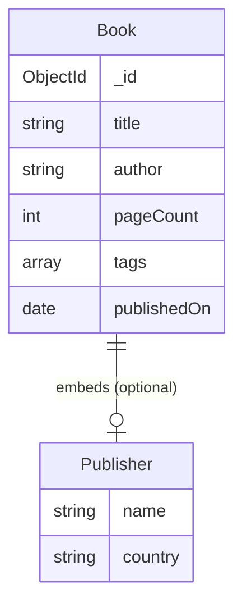

# EDD — Entity Document Diagram

Data model for the example code in this template, in
[EDD notation](https://github.com/mongodb-developer/edd-skill).

**This documents the template's example model, not your application's.** `Book` and
`Publisher` exist to demonstrate MongoDB modelling in C# - an embedded sub-document,
a bounded array, UTC dates and `ObjectId` mapping - and most projects will delete
them. This file is deliberately **not** shipped into generated projects, since a
scaffolded project would otherwise carry an EDD for a model it has removed. When you
replace the example with your own domain, generate a fresh `EDD.md` with the EDD
skill.

Generating with `--no-sample` omits this model entirely.

## Entities

```
Entity: Book    [indexes: {publishedOn:-1}, {tags:1}, {author:1,title:1}]

  _id: ObjectId                   # string in C#, [BsonRepresentation(BsonType.ObjectId)]
  title: string
  author: string
  pageCount: int32
  tags: string[0,3,20]            # multikey index; bounded by convention, not enforced
  publishedOn: date               # always UTC, normalised at the API boundary
  publisher: Publisher            # optional - omitted entirely when null, never stored as null


Entity: Publisher                 # embedded-only, no collection

  name: string
  country: string                 # ISO 3166-1 alpha-2, e.g. "CA"
```

Collection name: `books`, overridable via `MongoDB:BooksCollectionName`.

## Diagram



`||--o|` rather than `||--||`: `publisher` is nullable in C# and carries
`[BsonIgnoreIfNull]`, so a book either has exactly one embedded publisher or the
field is absent from the document. Zero-or-one, not exactly-one.

## Indexes

```
{ publishedOn: -1 }        // name: publishedOn_desc
{ tags: 1 }                // name: tags_asc  (multikey)
{ author: 1, title: 1 }    // name: author_title  (compound)
```

Created idempotently at startup by `Services/MongoDbIndexInitializer.cs`.

| Index | Serves |
| --- | --- |
| `publishedOn_desc` | The default listing, sorted newest first. A descending index also serves ascending sorts - MongoDB walks an index either way - so direction only matters for compound indexes. |
| `tags_asc` | "Find books tagged X". Indexing an array field indexes every element (a *multikey* index), so this is an index lookup rather than a collection scan. |
| `author_title` | Queries on `author`, and on `author` + `title` together. **Not** `title` alone - the prefix rule means a compound index is only usable from the left. |

Verified with `explain()`: the first two produce `IXSCAN`, a query on `author` alone
uses `author_title`, and a query on `title` alone correctly falls back to `COLLSCAN`.

## Modelling decisions

**`publisher` is embedded, not referenced.** It is always read with its book, has no
independent lifecycle here, and is a single small sub-document. Embedding makes it
one document and one round trip where a relational model would need a join. If
publishers gained their own lifecycle - an address, a contact, records updated
independently of any book - they would become their own collection, referenced by
`_id`, or an extended reference carrying just `{_id, name}`.

**`tags` is a bounded array.** The `[0,3,20]` tuple is a design assertion: tags are
expected to stay small. This is convention rather than an enforced limit - nothing in
the code rejects a 500-tag book. An array that can grow without bound is the classic
MongoDB anti-pattern, because documents cap at 16 MB and the whole array is rewritten
on update. If tags ever became unbounded, they would move to their own collection.

**No shard key.** The example is single-collection and small. A real deployment
expecting to exceed single-node capacity should choose one deliberately; `author`
alone would be a poor choice, since a prolific author creates a hot chunk.

**Dates are UTC.** BSON dates are always UTC milliseconds since the epoch.
`[BsonDateTimeOptions(Kind = DateTimeKind.Utc)]` makes the round trip explicit, and
the API normalises on the way in, so nothing downstream has to wonder.

## C# mapping

| EDD | C# |
| --- | --- |
| `_id: ObjectId` | `string? Id` with `[BsonId]` + `[BsonRepresentation(BsonType.ObjectId)]` - work with it as a string in routes and JSON, stored as a real `ObjectId` |
| `title: string` | `string Title` with `[BsonElement("title")]` |
| `tags: string[0,3,20]` | `List<string> Tags` |
| `publishedOn: date` | `DateTime PublishedOn` with `[BsonDateTimeOptions(Kind = DateTimeKind.Utc)]` |
| `publisher: Publisher` | `Publisher? Publisher` with `[BsonIgnoreIfNull]` |

Field names are camelCase in BSON. That is applied globally by
`CamelCaseElementNameConvention` in `Services/MongoDbRegistration.cs`; the explicit
`[BsonElement]` attributes on `Book` are belt and braces, kept because they are
useful to read.

See [`Models/Book.cs`](./Models/Book.cs) for the annotated source, and
[`Services/BookService.cs`](./Services/BookService.cs) for the queries these indexes
support.
