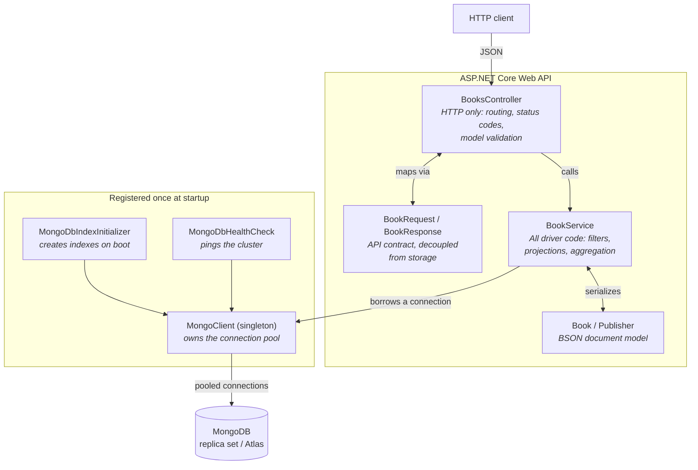

# .NET Web API Template for MongoDB

A `dotnet new` template that scaffolds a production-shaped ASP.NET Core Web API
wired to MongoDB. You pass your connection string on the command line and get a
project that already follows the MongoDB driver practices most apps get wrong -
a singleton client, tuned connection pooling, indexes created at startup, and a
health check that actually pings the cluster.

Every file is heavily commented on purpose. The template is meant to be read as much
as run, so the reasoning behind each setting sits next to the setting itself.

```bash
dotnet new install MongoDB.MongoDBWebAPIApp
dotnet new mongodb-webapi -n MyApi -c "mongodb+srv://..." --database myapp
```

## Capabilities

- **Singleton `MongoClient`** registered correctly in DI, with connection pool,
  timeout and retry settings chosen and explained rather than left at defaults.
- **Stable API v1** pinned, so a cluster upgrade can't silently change command
  behaviour.
- **Startup index creation**, idempotent and safe to re-run, demonstrating multikey
  and compound indexes and the prefix rule.
- **Health checks split into liveness and readiness** - `/health` pings MongoDB,
  `/health/live` deliberately doesn't, so a database outage can't trigger a restart
  loop.
- **A documented example model** showing `ObjectId` mapping, embedded sub-documents,
  arrays, and UTC date handling.
- **CRUD, projection and aggregation endpoints** in a controller that contains no
  driver code at all.
- **Config validated at startup**, so a bad connection string fails while booting
  with a clear message instead of timing out on the first request.
- **Secrets kept out of git** by default, with user-secrets and environment variable
  paths documented.
- **AI-ready**: ships MongoDB's official Claude Code plugin and a read-only MongoDB
  MCP server pointed at your database, so an assistant can read your real schema and
  generate models from it.
- **`--no-sample`** strips the example code and leaves just the MongoDB plumbing.

## Quick start

Install the template, either from NuGet or from a clone:

```bash
# From NuGet
dotnet new install MongoDB.MongoDBWebAPIApp

# Or from a local clone
git clone https://github.com/LuceCarter/WebApiProjectWithMongoDB.git
cd WebApiProjectWithMongoDB
dotnet new install .
```

Scaffold a project:

```bash
dotnet new mongodb-webapi -n Bookstore.Api \
  --connection-string "mongodb://localhost:27017" \
  --database bookstore
```

Run it:

```bash
cd Bookstore.Api
dotnet run
```

Then check the database connection and open the API explorer:

```bash
curl http://localhost:5241/health          # 200 once MongoDB is reachable
open http://localhost:5241/scalar/v1       # interactive API docs
```

The generated project's own `README.md` covers securing your connection string,
what each file does, and how to swap the example model for your own.

### Template options

| Option | Alias | Default | Description |
| --- | --- | --- | --- |
| `--connection-string` | `-c` | `mongodb://localhost:27017` | Written to `appsettings.Development.json`, which is gitignored |
| `--database` | | `appdb` | Database name. Does not need to exist - MongoDB creates it on first write |
| `--no-sample` | | off | Omit the example model, service, controller and requests file |
| `--no-restore` | | off | Skip the automatic `dotnet restore` |

Requires the **.NET 10 SDK** and any MongoDB deployment - a local `mongod`, a
container, or [MongoDB Atlas](https://www.mongodb.com/atlas) (the free tier is
plenty).

## Architecture overview

A request never touches the driver directly. Controllers deal in HTTP, services deal
in MongoDB, and the single shared `MongoClient` owns the connection pool underneath
both.



Why this shape: keeping every driver call inside `BookService` means the HTTP layer
never sees a `FilterDefinition` or a `BsonDocument`, and you can change how data is
stored without touching your API surface. Separate request and response types mean
adding an internal field to a document doesn't silently leak into your public API.

## Why MongoDB?

The gap between "MongoDB works" and "MongoDB works well" is almost entirely
configuration and modelling, and it stays invisible until you have real traffic.
This template closes that gap up front.

- **Documents match the shape of your API.** A `Book` with a nested publisher and an
  array of tags is one document and one round trip, where a relational model needs
  three tables and two joins. See
  [`Models/Book.cs`](./Models/Book.cs) and the
  [data modelling guide](https://www.mongodb.com/docs/manual/data-modeling/).
- **Flexible schema that survives deploys.** `IgnoreExtraElementsConvention` lets a
  field appear in your documents before the code that reads it ships - essential for
  rolling deploys. See
  [`Services/MongoDbRegistration.cs`](./Services/MongoDbRegistration.cs).
- **Indexes designed alongside the queries they serve**, including a multikey index
  over an array field and a compound index that demonstrates the prefix rule. See
  [`Services/MongoDbIndexInitializer.cs`](./Services/MongoDbIndexInitializer.cs) and
  [indexing strategies](https://www.mongodb.com/docs/manual/applications/indexes/).
- **Aggregation runs on the server**, so grouping and summing transfer results rather
  than raw documents. See
  [`Services/BookService.cs`](./Services/BookService.cs) and the
  [aggregation docs](https://www.mongodb.com/docs/manual/aggregation/).
- **Connection pooling that holds up under load.** One `MongoClient` for the process
  lifetime, with pool size and timeouts sized for a long-running web server and the
  reasoning written next to each value. See
  [`Services/MongoDbRegistration.cs`](./Services/MongoDbRegistration.cs) and
  [connection pool tuning](https://www.mongodb.com/docs/drivers/csharp/current/connect/connection-options/connection-pools/).

### MongoDB features demonstrated

| Feature | Where |
| --- | --- |
| Singleton client, pool and timeout tuning | `Services/MongoDbRegistration.cs` |
| [Stable API](https://www.mongodb.com/docs/manual/reference/stable-api/) v1 | `Services/MongoDbRegistration.cs` |
| Serialization conventions (camelCase, ignore nulls, ignore extra elements) | `Services/MongoDbRegistration.cs` |
| Driver logging routed into `ILogger` | `Services/MongoDbRegistration.cs` |
| [`ObjectId`](https://www.mongodb.com/docs/manual/reference/bson-types/#objectid) mapped to `string`, embedded documents, arrays, UTC dates | `Models/Book.cs` |
| Multikey and compound indexes, prefix rule | `Services/MongoDbIndexInitializer.cs` |
| Find, bounded pagination, projection, `$set` update, delete | `Services/BookService.cs` |
| [Aggregation pipeline](https://www.mongodb.com/docs/manual/aggregation/) (`$group`, `$sort`) | `Services/BookService.cs` |
| Health check via `ping` | `Services/MongoDbHealthCheck.cs` |

## Working with AI assistants

Generated projects ship three things that make an AI assistant useful here rather
than merely enthusiastic:

- **`.claude/settings.json`** enables MongoDB's
  [official plugin](https://github.com/mongodb/agent-skills), bringing skills for
  connection management, schema design, indexing, query optimisation and Atlas
  Search.
- **`.mcp.json`** points the MongoDB MCP server at the connection string you passed
  in, **read-only**. An assistant can read your real collection schemas, sample
  documents and run `explain()` - so "generate a C# model for my `products`
  collection" works against your actual data - but cannot modify anything.
- **`CLAUDE.md`** records the project's conventions, so generated code matches the
  codebase instead of fighting it.

## Contributing

See [AGENTS.md](./AGENTS.md) for build and test commands, project structure and how
the template engine is wired up. The short version: a green `dotnet build` at the
repo root proves very little, because most defects here are template-engine defects.
Always generate a project and build *that*. CI does exactly this on every push.

## Additional resources

- [MongoDB C#/.NET driver documentation](https://www.mongodb.com/docs/drivers/csharp/current/)
- [MongoDB Atlas](https://www.mongodb.com/atlas) - free tier for local development
- [ASP.NET Core Web API documentation](https://learn.microsoft.com/aspnet/core/web-api/)
- [Custom `dotnet new` templates](https://learn.microsoft.com/dotnet/core/tools/custom-templates)

## License

[Apache-2.0](./LICENSE).
